# Manual del panel del sitio

Este manual es para el personal que mantiene al día el sitio web: noticias, eventos, avisos,
documentos, carreras y fotos. No hace falta saber de computación; si sabes escribir un correo,
sabes usar el panel.

> Las capturas son de la versión de demostración. Los nombres y textos que veas son de ejemplo.

---

## 1. Entrar al panel

1. Abre el sitio y agrega `/admin` al final de la dirección. Ejemplo: `universidad.edu.ve/admin`.
2. Escribe tu **correo** y tu **contraseña**, y pulsa **Iniciar sesión**.

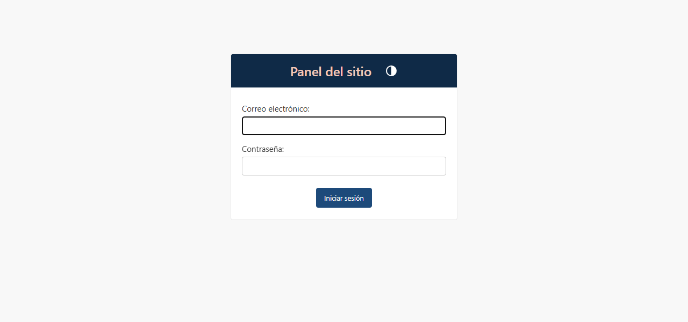

Si te equivocas 5 veces seguidas, el ingreso se bloquea 15 minutos por seguridad. Si olvidaste tu
contraseña, usa **«¿Olvidaste tu contraseña?»** en la página **Ingresar** del sitio.

## 2. Quién puede hacer qué

Cada persona tiene un rol. Lo asigna el administrador técnico (ver la sección 12).

| Acción | Editor | Aprobador | Administrador técnico |
|---|---|---|---|
| Crear y editar noticias, eventos, avisos, documentos, carreras y fotos | Sí | Sí | Sí |
| Publicar sin que nadie revise | Solo donde no se exige aprobación | Sí | Sí |
| Aprobar o devolver con comentarios | No | Sí | Sí |
| Borrar contenido | Solo sus propios borradores | Sí | Sí |
| Editar los datos generales del sitio | No | Sí | Sí |
| Crear cuentas y asignar roles | No | No | Sí |

## 3. La pantalla de inicio

Al entrar ves la lista de todo lo que puedes editar. Arriba aparece el recuadro **Flujo de
publicación**:

- Si eres **aprobador**, te dice cuántas cosas esperan tu revisión.
- Si eres **editor**, te avisa cuando te devuelven algo con comentarios para corregir.

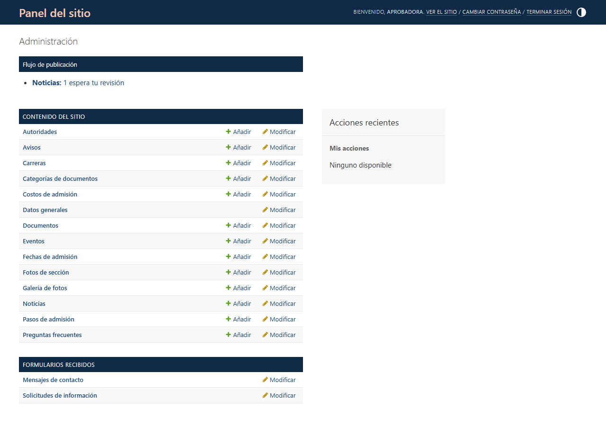

## 4. Publicar una noticia

1. En el inicio, junto a **Noticias**, pulsa **Añadir**.
2. Completa:
   - **Título**: corto y claro, por ejemplo «Abierto el proceso de admisión».
   - **Dirección**: se llena sola a partir del título. No la cambies después de publicar: es el
     enlace que la gente comparte.
   - **Resumen**: una o dos frases. Se ve en las tarjetas de la portada.
   - **Cuerpo**: el texto completo. **Deja una línea en blanco entre párrafos**; el sitio se
     encarga del diseño.
   - **Imagen**: una foto horizontal. Debajo, en **Descripción de la imagen**, explica qué muestra
     (lo usan las personas ciegas con su lector de pantalla).
   - **Fecha de publicación**: si pones una fecha futura, la noticia aparece sola ese día.
3. En **Publicación › Estado** elige:
   - **Borrador**: la guardas para seguir después. No se ve en el sitio.
   - **En revisión**: se la mandas a un aprobador. Le llega un correo.
   - **Publicado**: solo aparece si tu rol lo permite.
4. Pulsa **Guardar**.

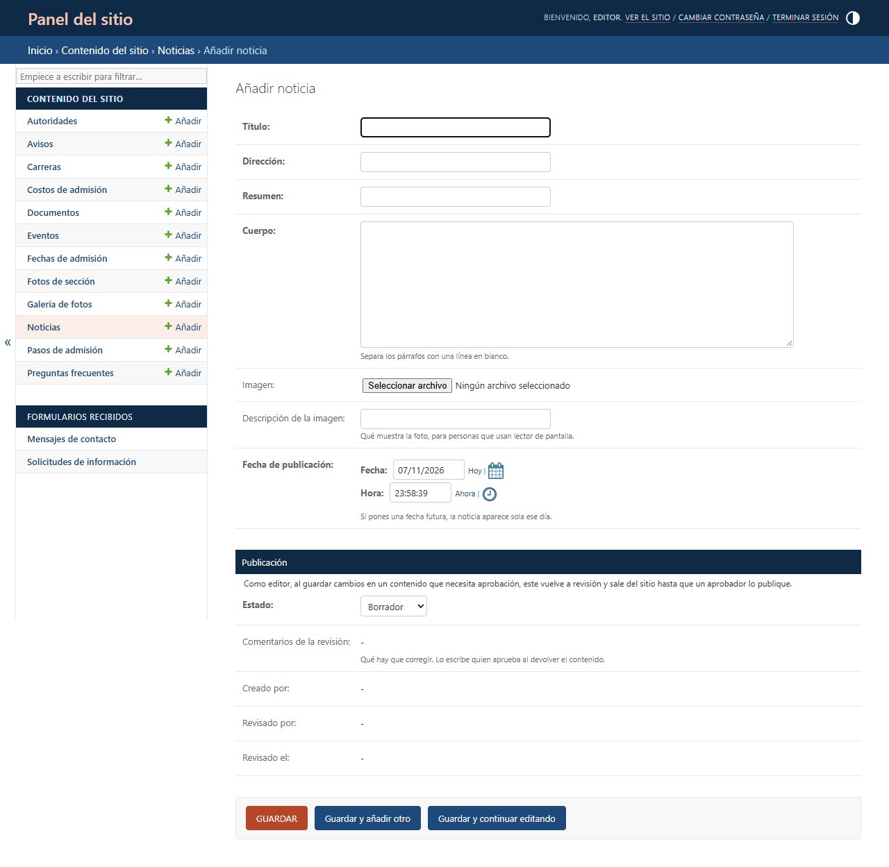

En la lista de noticias ves el estado de cada una con un color:
gris = borrador, amarillo = en revisión, verde = publicado, rojo = devuelto.

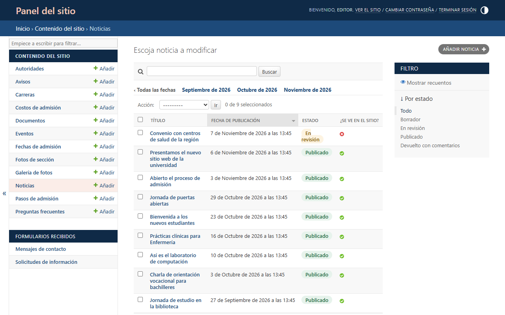

> **Importante para editores:** si cambias algo de un contenido ya publicado que necesita
> aprobación, vuelve a revisión y sale del sitio hasta que un aprobador lo publique otra vez.

## 5. Revisar y aprobar (aprobadores)

1. En el inicio, pulsa el enlace del recuadro **Flujo de publicación** (o filtra la lista por
   **En revisión**).
2. Abre el contenido y léelo.
3. En **Publicación › Estado**:
   - Para publicarlo, elige **Publicado** y guarda.
   - Si hay que corregir algo, elige **Devuelto con comentarios**, escribe en **Comentarios de la
     revisión** qué cambiar y guarda. A quien lo escribió le llega un correo con tus comentarios.

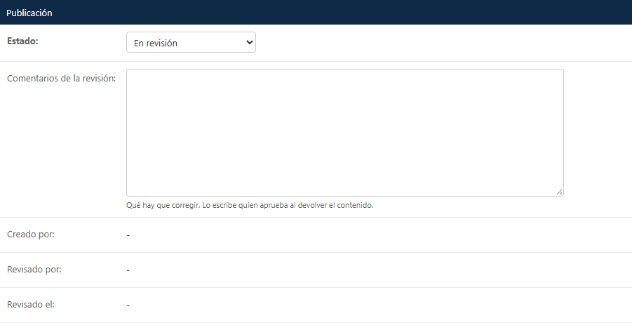

Para aprobar varias cosas a la vez: en la lista, marca las casillas, elige **Aprobar y publicar**
en el menú **Acción** y pulsa **Ir**.

Qué tipos de contenido necesitan aprobación lo decide la universidad en **Datos generales ›
Flujo de publicación** (sección 10).

## 6. Eventos y avisos

**Eventos** (aparecen en el calendario y en la portada): nombre, día y hora de inicio, hora de fin
si la hay, lugar y una descripción.

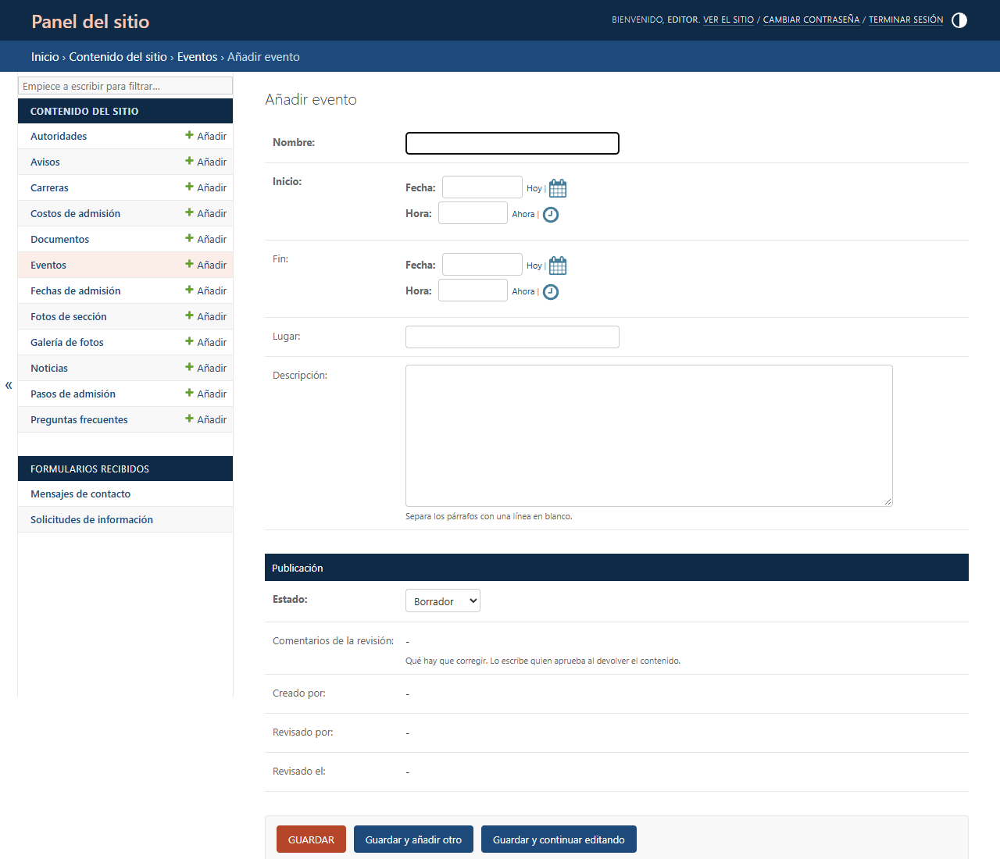

**Avisos** (franja de color en la portada y en Noticias): un texto corto, un enlace opcional (por
ejemplo `/admision`) y la fecha en que **vence**. Al día siguiente desaparecen solos.

## 7. Documentos y reglamentos (Normativa)

1. Junto a **Documentos**, pulsa **Añadir**.
2. Escribe el nombre, elige la **categoría** (Reglamentos, Documentos legales o Formatos
   descargables), sube el archivo (PDF, Word o Excel) y guarda.

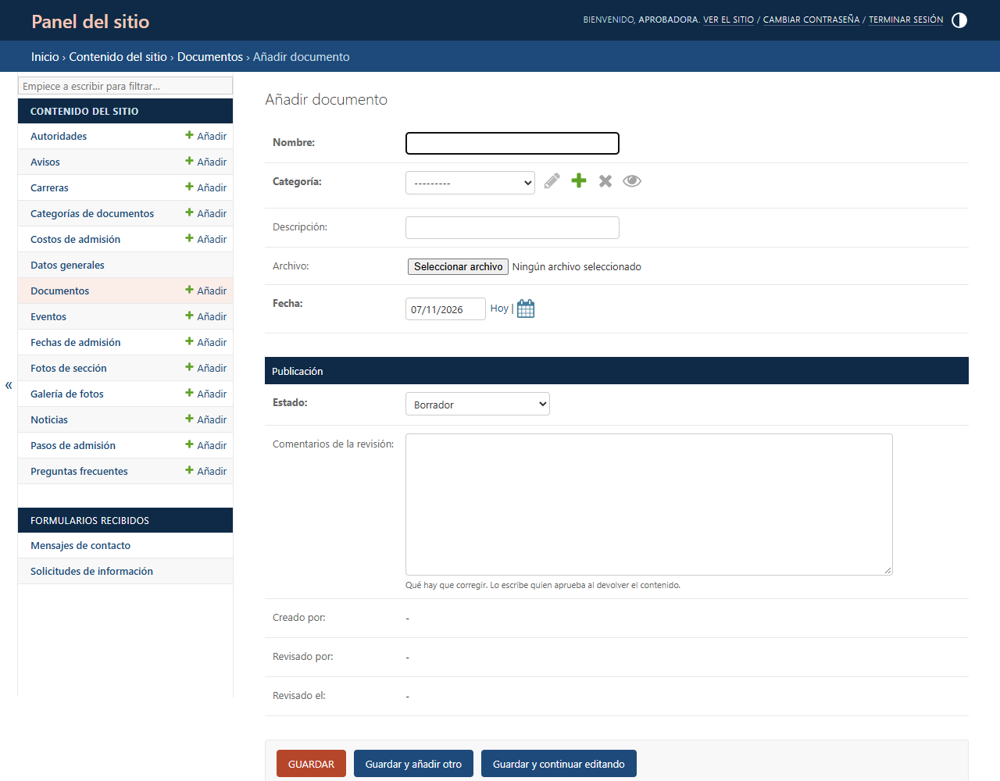

El sitio muestra solo el formato y el peso del archivo para que la gente sepa qué va a descargar.
Las **categorías** las administra un aprobador.

## 8. Carreras y pensum

Cada carrera tiene su ficha rápida (título, duración, modalidad y turno), su foto, la presentación,
el perfil del egresado y el campo laboral. En **Perfil del egresado** y **Campo laboral** escribe
**un elemento por línea**.

El **pensum** se carga asignatura por asignatura al final de la página de la carrera: semestre,
código, nombre y unidades de crédito. Para agregar una, completa la fila vacía o pulsa el enlace
verde **Añadir…** que está debajo de la lista. Sube también el **PDF** del pensum completo.

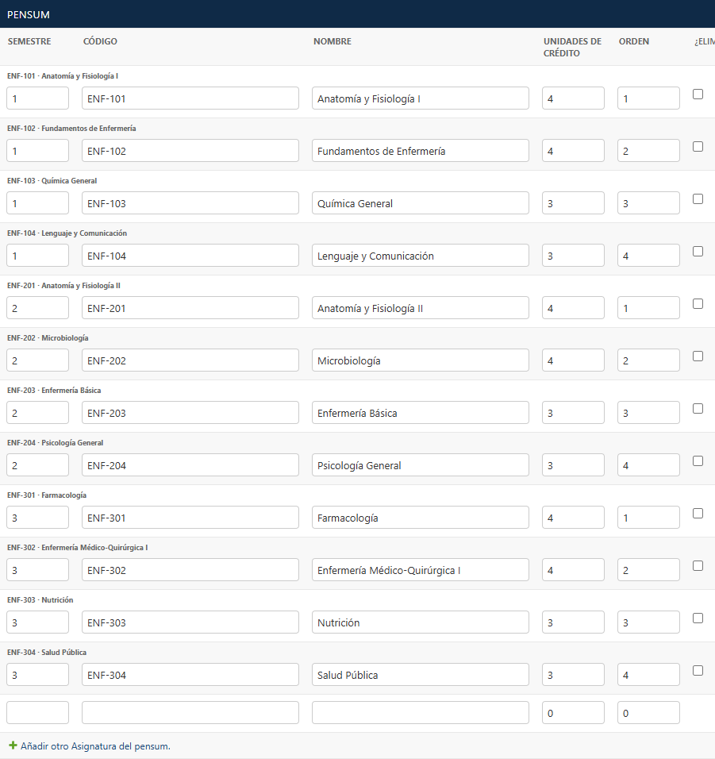

Si el pensum todavía no es el aprobado, marca **El pensum es de ejemplo** y el sitio lo avisará.

En **Álbum de la carrera** elige el álbum con sus fotos (laboratorio, prácticas, clases): sus
primeras cuatro fotos aparecen en la página de la carrera.

## 9. Galería de fotos

Cada **álbum** tiene título, fecha y sus fotos. Agrega fotos en las filas de abajo; a cada una
escríbele una descripción de lo que se ve.

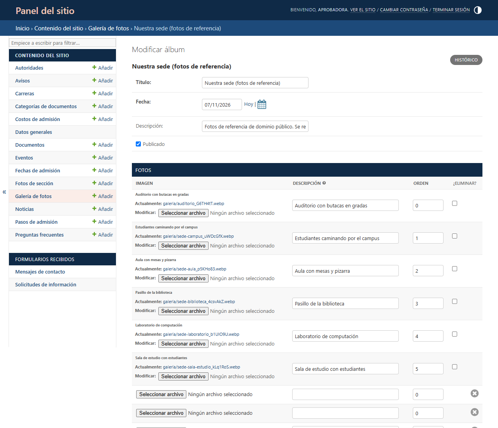

**Consejos para las fotos**

- Fotos reales de la sede, las aulas y la gente. Horizontales, de al menos 1600 píxeles de ancho.
- No hace falta achicarlas: el sitio genera solo las versiones para teléfono y computadora.
- Pide permiso a las personas que aparezcan, sobre todo si son menores de edad.

## 10. Datos generales del sitio (aprobadores)

Una sola página con todo lo que aparece en muchas partes del sitio: nombre, lema, frase y foto de
la portada, dirección, teléfonos, correos, horario, redes sociales, historia, misión, visión,
valores, sede, organigrama, datos legales, requisitos de admisión, costos y aviso de privacidad.

También están aquí:

- **Mostrar aviso de demostración**: desmárcalo cuando todo el contenido oficial esté cargado.
- **Publicar costos en Admisión**: muestra u oculta la tabla de costos.
- **Flujo de publicación**: qué tipos de contenido necesitan aprobación.
- **Cifras**: los datos que se ven en grande en la portada, uno por línea con el formato
  «número: qué es» (por ejemplo, «3: carreras»). Solo datos reales y verificables.
- **Foto de la portada**: la foto de la sede que abre el sitio.

**Fotos de sección** (en la lista del inicio del panel) guarda la foto de la franja de arriba de
cada sección: La Universidad, Carreras, Admisión, Noticias, Normativa, Contacto y Buscar.

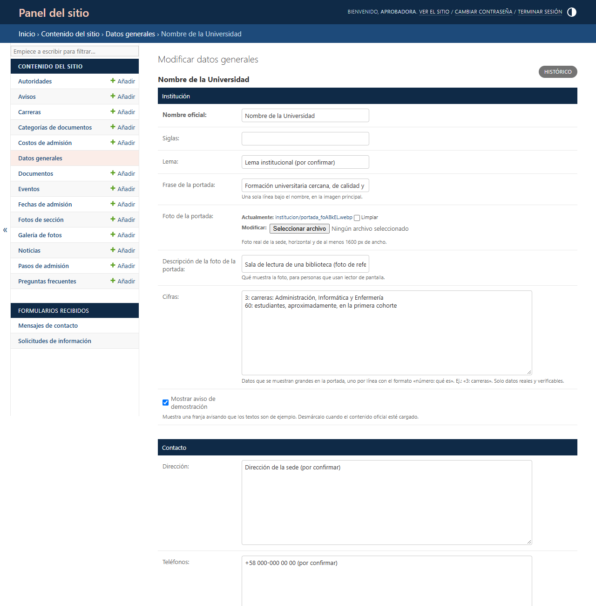

## 11. Formularios recibidos

Lo que la gente envía desde **Contacto** y **Solicitar información** llega por correo a admisión y
queda guardado aquí. Para contestar, responde el correo: le llega directo a la persona. Cuando lo
atiendas, márcalo como **atendido** (o selecciona varios y usa la acción **Marcar como
atendidos**).

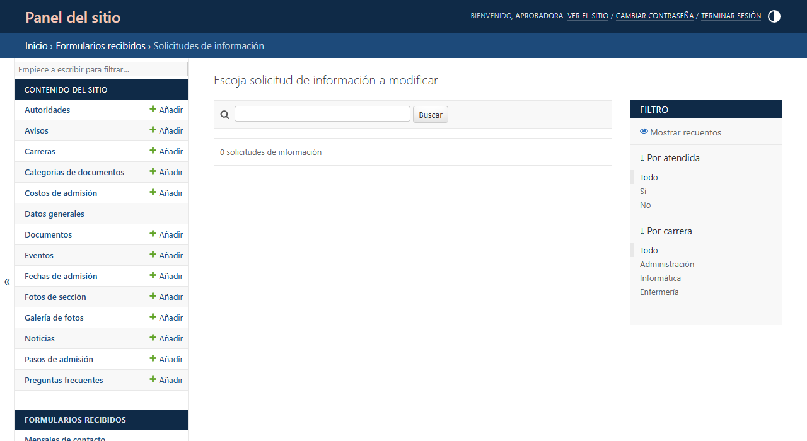

## 12. Cuentas y roles (administrador técnico)

1. Ve a **Usuarios y roles › Usuarios** y pulsa **Añadir**, o abre una cuenta existente.
2. Para que alguien entre al panel, abre la sección **Acceso al panel** (está plegada) y marca
   **Acceso al panel**.
3. En **Roles**, pasa a la derecha **Editor de contenido** o **Aprobador de contenido** y guarda.

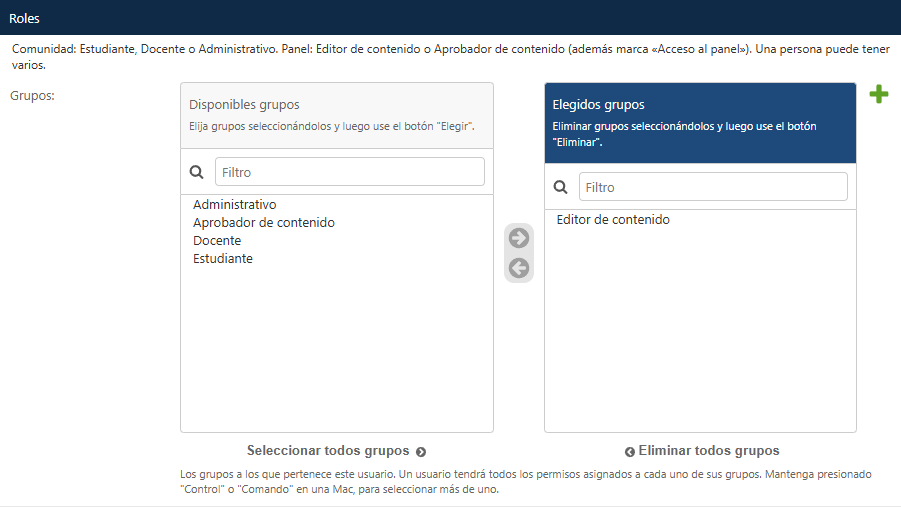

Los roles de la comunidad (Estudiante, Docente y Administrativo) se asignan en el mismo lugar.
Una persona puede tener varios.

## 13. Lo que no se edita desde el panel

El menú, las secciones, los colores, las letras y las direcciones de las páginas son fijos. Así
nadie rompe el diseño por accidente. Si hace falta cambiarlos, se pide al equipo de desarrollo.

## 14. Si algo sale mal

- **«Por seguridad bloqueamos el ingreso…»**: espera 15 minutos o recupera tu contraseña.
- **No veo una noticia en el sitio**: revisa que esté en **Publicado** y que la fecha de
  publicación no sea futura.
- **Me devolvieron algo**: ábrelo, lee **Comentarios de la revisión**, corrige y vuelve a
  ponerlo **En revisión**.
- **Borré algo por error**: avisa al administrador técnico; hay copias de seguridad diarias.
